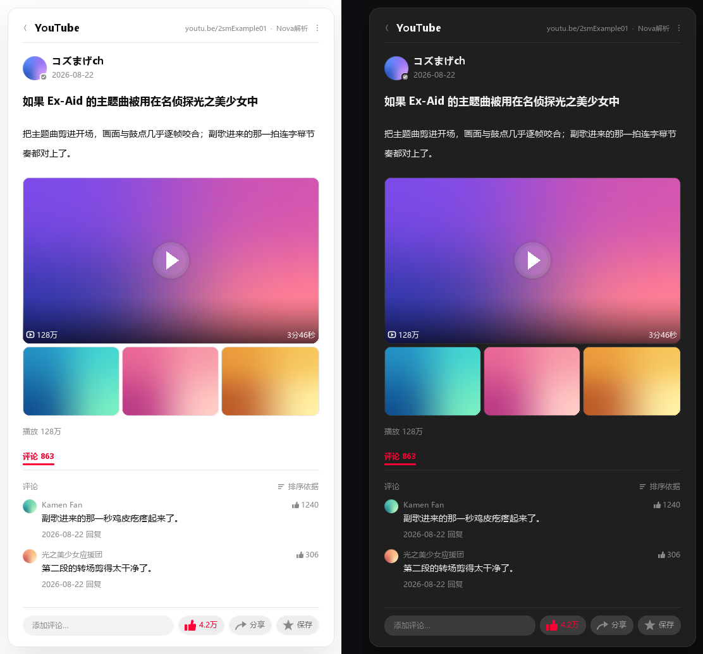

# YouTube Nova

面向 AstrBot 的独立 YouTube 媒体解析插件。视频流统一由 yt-dlp 解析，Innertube 负责补充标题、头像、统计、热评与登录态诊断。



## 功能

- 支持普通视频、Shorts、直播回放、YouTube Music 与常见分享链接
- yt-dlp + JS challenge 取流，可选 PO Token provider
- 媒体头部、中段、尾段预检，受限时自动回退到可下载格式并提示画质变化
- 浏览器 Profile 或手动 Cookie，支持自动同步、轮换、续活和失效提醒
- DASH 音视频合并，超限原视频直接作为群文件/私聊文件发送，支持 NapCat、SnowLuma、LLBot
- 自动选择共享本地路径或 HTTP 文件服务，适应同机、跨容器和分离部署
- 作者头像、播放量、点赞数、评论数和公开热评
- YouTube 仿站皮肤与五套通用皮肤，支持深浅色和四种布局
- 文本、卡片、富媒体、翻译、聚合、归档和频率限制
- 管理员 `/yt_status`（或 `/油管状态`）本机诊断依赖、缓存和配置状态
- 单条消息默认最多解析 3 个唯一链接，可在触发设置中调整为 1–20

## 安装

新服务器先阅读[安装与首次验证](docs/installation.md)，包含 Linux、Windows、Docker、可选 PO Token 的完整步骤。

1. 准备 AstrBot `>=4.25.0,<5`，新部署使用 Python 3.12 或 3.13。
2. 在 **AstrBot 实际运行环境**中准备 `ffmpeg`、`ffprobe` 和一个受支持的 JS 运行时。推荐 Node.js 24 LTS；容器部署需要安装在容器内。
3. 在 AstrBot 插件市场使用仓库地址安装：

```text
https://github.com/Whereis-Alice/astrbot_plugin_youtube_nova
```

4. 重启 AstrBot，以管理员身份发送 `/yt_status`，再发送一个可公开访问的短视频链接，确认收到视频且声音正常。

`requirements.txt` 中的 Python 依赖会由插件安装流程安装，其中包含 `yt-dlp` 与 `yt-dlp-ejs`；FFmpeg、JS 运行时和可选的 PO Token 组件需要管理员准备。第一次验证可保持默认配置、Cookie 留空，先使用匿名取流。

需要 PO Token 时，仓库提供[配套安装工具](tools/setup_pot_provider.py)，安装固定版本的 Python 提供方和匹配的官方生成脚本；不会自动修改 AstrBot 配置。具体命令见[PO Token 部署](docs/installation.md#可选部署-po-token)。组件、Cookie、浏览器 Profile 和代理配置均由安装者管理，仓库不依赖任何作者服务器的路径或账号。

## 配置要点

- 匿名验证通过后，如内容或出口确实需要登录态，再配置手动 Cookie；有图形桌面的长期服务器也可选择“浏览器 Profile”及有头浏览器续活。
- “可发送视频体积上限”默认 48 MiB；超过后默认直接发送原视频文件，跳过压缩。例如 169.7 MiB 的长视频直接上传群文件，保留原画质。
- 从旧版本升级时，将“超限视频投递方式”设为“上传为文件（群聊/私聊）”。旧配置中的“仅发送信息与封面”会保留；选择文件投递后，即使旧压缩开关仍开着，超限视频也会直接发送原文件。
- 三个 QQ 协议端均通过 AstrBot 的 aiocqhttp / OneBot v11 接入。分离部署需设置可由协议端访问的 AstrBot `callback_api_base`，详见[配置说明](docs/configuration.md)。
- 代理解析与媒体下载必须走同一出口，否则 googlevideo 直链可能返回 403。
- PO Token 提供方的 Python 插件与生成脚本/服务需要主版本一致；取流成功但中后段 403 时，可在组件匹配后尝试“总是”取令牌。它不能替代有效登录态。
- Cookie、代理和浏览器 Profile 都是本机凭据，不要提交到仓库、Issue 或日志。

诊断命令仅 AstrBot 管理员可用；只检查本机依赖与配置，不验证 Cookie 是否有效。

安装步骤见[安装与首次验证](docs/installation.md)，完整配置见[配置说明](docs/configuration.md)，取流、Cookie 与排障见[YouTube 说明](docs/youtube.md)。

## 许可

主体遵循 [GNU Affero General Public License v3.0](LICENSE)。`LICENSES/` 保留第三方许可文本。
